<div align="center">

<picture>
  <source media="(prefers-color-scheme: dark)" srcset="assets/readme/banner-dark.png">
  <source media="(prefers-color-scheme: light)" srcset="assets/readme/banner-light.png">
  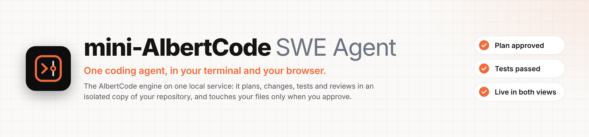
</picture>

<br>

<p>
<a href="https://github.com/huynvic/mini-albertcode-swe-agent/releases/latest"></a>
<a href="docs/installation.md"></a>
<a href="https://github.com/huynvic/mini-albertcode-swe-agent/actions/workflows/checks.yml"></a>
</p>

<h3>
<a href="#install">Install</a>
<span>&nbsp;·&nbsp;</span>
<a href="#quick-start">Quick start</a>
<span>&nbsp;·&nbsp;</span>
<a href="#how-it-works">How it works</a>
<span>&nbsp;·&nbsp;</span>
<a href="#documentation">Docs</a>
<span>&nbsp;·&nbsp;</span>
<a href="https://github.com/huynvic/mini-albertcode-swe-agent/releases">Releases</a>
<span>&nbsp;·&nbsp;</span>
<a href="https://github.com/huynvic/mini-albertcode-swe-agent/issues/new/choose">Issues</a>
</h3>

<br>

<picture>
  <source media="(prefers-color-scheme: dark)" srcset="assets/readme/screen-outcome-dark.png">
  <source media="(prefers-color-scheme: light)" srcset="assets/readme/screen-outcome-light.png">
  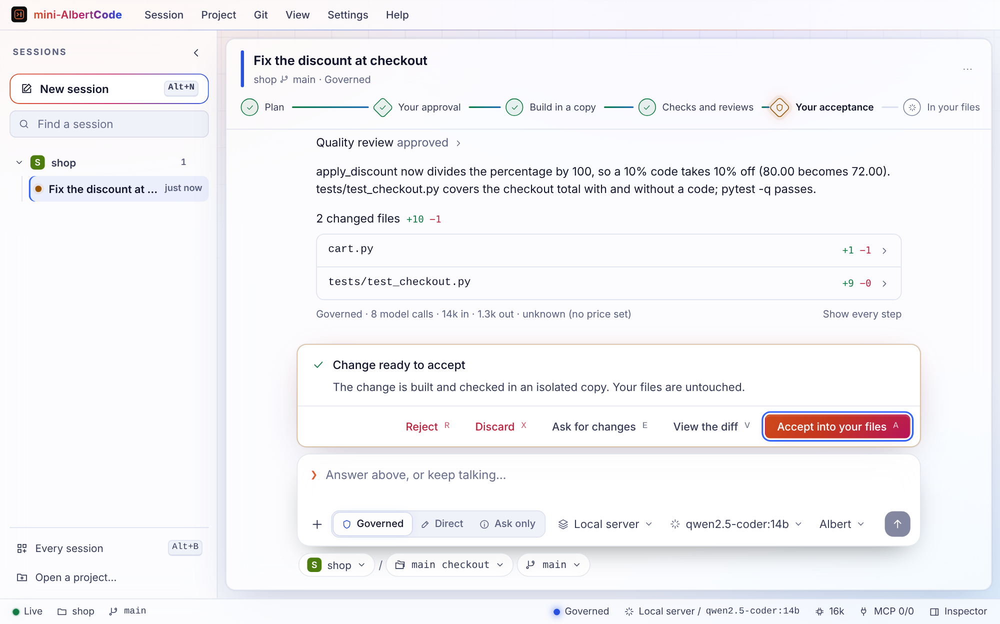
</picture>

<sub>A task in the mini-AlbertCode browser workspace, waiting at the second gate.</sub>

</div>

<br>

## Contents

<table>
<tr>
<td valign="top" width="33%">

**Get started**<br>
[Install](#install)<br>
[Update and uninstall](#update-and-uninstall)<br>
[Quick start](#quick-start)

</td>
<td valign="top" width="33%">

**Learn**<br>
[See it in action](#see-it-in-action)<br>
[Why mini-AlbertCode](#why-mini-albertcode)<br>
[How it works](#how-it-works)<br>
[Using mini-AlbertCode](#using-mini-albertcode)<br>
[Models](#models)

</td>
<td valign="top" width="33%">

**Reference**<br>
[Troubleshooting](#troubleshooting)<br>
[Privacy and security](#privacy-and-security)<br>
[Documentation](#documentation) · [FAQ](#faq)

</td>
</tr>
</table>

<br>

## Install

One command installs mini-AlbertCode for your user. Pick your system:

#### macOS and Linux &nbsp;<sub>Terminal</sub>

```bash
curl -fsSL https://raw.githubusercontent.com/huynvic/mini-albertcode-swe-agent/main/installer/install.sh | sh
```

#### Windows &nbsp;<sub>PowerShell</sub>

```powershell
irm https://raw.githubusercontent.com/huynvic/mini-albertcode-swe-agent/main/installer/install.ps1 | iex
```

The command picks the installer built for your machine and checks it against the release's published
SHA-256 checksum. The installer then checks your machine, shows what it found and what it will do, and
asks `Proceed? [Y/N]` before it changes anything. It installs everything mini-AlbertCode needs,
including Python, for your user only. No pip, virtual environments or PATH editing. It takes a minute
or two.

> [!TIP]
> When it finishes, **open a new terminal**, then check it:
>
> ```bash
> albert-mini --version     # mini-AlbertCode SWE Agent 0.1.8 (AlbertCode engine 1.51.1)
> albert-mini doctor        # the installation, the service, and what to do about any problem
> ```

### Requirements

| | |
|---|---|
| **Windows** | Windows 10 or 11, x64 (the x64 build also runs on ARM PCs). PowerShell 5.1 or 7 |
| **macOS** | macOS 11 or later, on Apple silicon or Intel |
| **Linux** | x86-64 with glibc: Ubuntu 20.04+, Debian 10+, Fedora, RHEL 8+, openSUSE, Arch. Not Alpine or other musl systems |
| **Disk** | About 1 GB free |
| **Network** | pypi.org and github.com while installing; your model provider while working |
| **Git** | Needed. The installer installs it if it's missing, after asking |

You don't need Python: the installer uses your Python 3.12 if you have it, and otherwise downloads one
for mini-AlbertCode alone.

### Step by step

<details>
<summary><b>macOS</b> &nbsp;·&nbsp; Terminal, or the downloadable <code>.zip</code></summary>

<br>

1. Open **Terminal** (Applications → Utilities, or press ⌘ Space and type *Terminal*).
2. Paste the macOS command above and press Return.
3. Read the plan, then type `Y`.
4. Close Terminal and open a new window, then run `albert-mini --version`.

**Prefer a download?** From the [latest release](https://github.com/huynvic/mini-albertcode-swe-agent/releases/latest),
take the `.zip` for your Mac: `macos-arm64` for Apple silicon (M1 and later), `macos-x86_64` for Intel.
Not sure which you have? Open the Apple menu → *About This Mac*. Open the zip, then double-click the
installer inside it.

> [!NOTE]
> The installers aren't code-signed yet, so the first time macOS says it can't verify the installer.
> Choose *Done*, open **System Settings → Privacy & Security**, click **Open Anyway**, then open the
> installer again. The one-line command above avoids this.

</details>

<details>
<summary><b>Windows</b> &nbsp;·&nbsp; PowerShell, or the downloadable <code>.cmd</code></summary>

<br>

1. Open **PowerShell**: press the Windows key, type *PowerShell*, and press Enter. You don't need "Run
   as administrator".
2. Paste the Windows command above and press Enter.
3. Read the plan, then type `Y`.
4. Close PowerShell and open a new window, then run `albert-mini --version`.

**Prefer a download?** From the [latest release](https://github.com/huynvic/mini-albertcode-swe-agent/releases/latest),
take `Install-mini-AlbertCode-<version>-windows-x64.cmd` and double-click it.

> [!NOTE]
> The installers aren't code-signed yet, so SmartScreen may say it protected your PC. Choose
> *More info* → *Run anyway*. If your organisation blocks PowerShell scripts, use the downloaded
> `.cmd` installer instead.

</details>

<details>
<summary><b>Linux</b> &nbsp;·&nbsp; any terminal, or the downloadable <code>.sh</code></summary>

<br>

1. Open a terminal. Make sure `curl` is installed (`sudo apt install curl` on Ubuntu and Debian).
2. Paste the Linux command above and press Enter. Run it as yourself, not with `sudo`.
3. Read the plan, then type `Y`. It asks for your password only if it needs to install Git or a browser.
4. Open a new terminal, then run `albert-mini --version`.

**Prefer a download?** From the [latest release](https://github.com/huynvic/mini-albertcode-swe-agent/releases/latest),
take `Install-mini-AlbertCode-<version>-linux-x86_64.sh` and run
`bash Install-mini-AlbertCode-<version>-linux-x86_64.sh`.

</details>

<details>
<summary><b>Installer options</b></summary>

<br>

`--check` only shows the plan, `--yes` installs without asking (for scripts and CI), `--reinstall`
installs the same version again, and `--version X.Y.Z` installs a specific release. On Windows, put
options in `MINI_ALBERTCODE_INSTALL_ARGS`, as in the uninstall command below. Manual checksum checks,
proxies and more are in [Installation](docs/installation.md).

</details>

<br>

## Update and uninstall

### Update

```bash
albert-mini update
```

It reads the latest release, says whether it is newer than yours, checks its installer against the
release's SHA-256 and runs it. The installer finds the version you have and shows its plan
(`Update mini-AlbertCode 0.1.0 to 0.2.0 …`), then asks before it replaces anything. Running the install
command again does the same.

> [!IMPORTANT]
> Your sessions are always kept. Saved keys and model choices are kept too, unless the new version
> carries a new AlbertCode engine: then the plan says they will be cleared the first time it starts, and
> you reconnect with `/connect`.

### Uninstall

On any system (macOS, Linux and Windows). It needs nothing from the internet:

```bash
albert-mini uninstall
```

<details>
<summary>Or with the install script</summary>

<br>

**macOS and Linux** &nbsp;<sub>Terminal</sub>

```bash
curl -fsSL https://raw.githubusercontent.com/huynvic/mini-albertcode-swe-agent/main/installer/install.sh | sh -s -- --uninstall
```

**Windows** &nbsp;<sub>PowerShell</sub>

```powershell
$env:MINI_ALBERTCODE_INSTALL_ARGS = '--uninstall'; irm https://raw.githubusercontent.com/huynvic/mini-albertcode-swe-agent/main/installer/install.ps1 | iex
```

</details>

Uninstalling lists what it will remove and asks first. Your settings are kept: with
`albert-mini uninstall`, `--all` also removes your settings, saved keys, sessions and history, and
`--check` only shows the plan. Your repositories are never touched.

<br>

## Quick start

```bash
cd your-project
albert-mini
```

The first time, mini-AlbertCode opens **Connect a provider**: pick one, give it your key or its address,
and choose a model. Then describe what you want:

```text
your-project · gpt-4o · governed ❯ The login endpoint returns 500 when the password is empty. Fix it and add a test.
```

mini-AlbertCode reads the repository and proposes a plan. You approve the plan. It makes the change in
an isolated copy, runs your tests, reviews the result, and shows you the diff. You accept it, and only
then does the change reach your files. Prefer the browser? Run `albert-mini web`: it shows the same
session, live.

> [!TIP]
> [Getting started](docs/getting-started.md) walks through a first task in about five minutes.

<br>

## See it in action

One request, from plan to proof. Every screen below is the same task, followed in both interfaces.

<table>
<tr>
<td width="50%" valign="top">

**1 · You approve the plan**

<picture>
  <source media="(prefers-color-scheme: dark)" srcset="assets/readme/screen-plan-dark.png">
  <source media="(prefers-color-scheme: light)" srcset="assets/readme/screen-plan-light.png">
  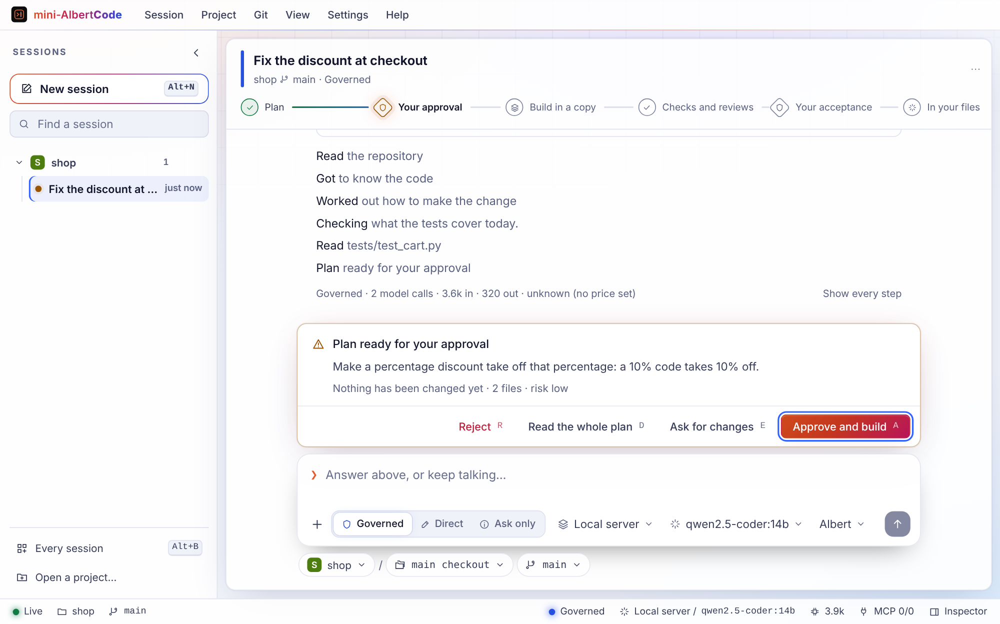
</picture>

<sub>The goal, the files it will change and how, its tests and its risk. Nothing is written yet.</sub>

</td>
<td width="50%" valign="top">

**2 · It shows you the exact diff**

<picture>
  <source media="(prefers-color-scheme: dark)" srcset="assets/readme/screen-diff-dark.png">
  <source media="(prefers-color-scheme: light)" srcset="assets/readme/screen-diff-light.png">
  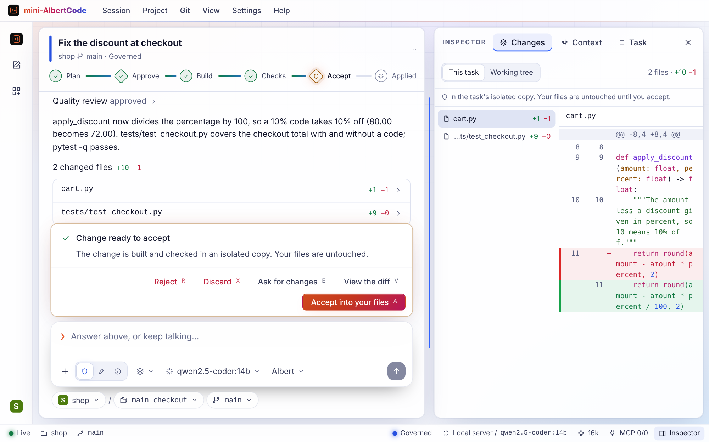
</picture>

<sub>Built in an isolated copy of your repository, never in your working tree.</sub>

</td>
</tr>
<tr>
<td width="50%" valign="top">

**3 · With the evidence**

<picture>
  <source media="(prefers-color-scheme: dark)" srcset="assets/readme/screen-evidence-dark.png">
  <source media="(prefers-color-scheme: light)" srcset="assets/readme/screen-evidence-light.png">
  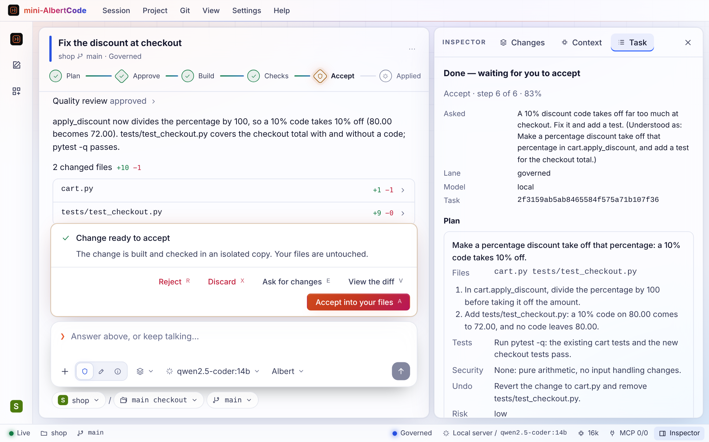
</picture>

<sub>Your own tests and two independent reviews, kept with the task.</sub>

</td>
<td width="50%" valign="top">

**4 · In your terminal, too**

<picture>
  <source media="(prefers-color-scheme: dark)" srcset="assets/readme/screen-terminal-dark.png">
  <source media="(prefers-color-scheme: light)" srcset="assets/readme/screen-terminal-light.png">
  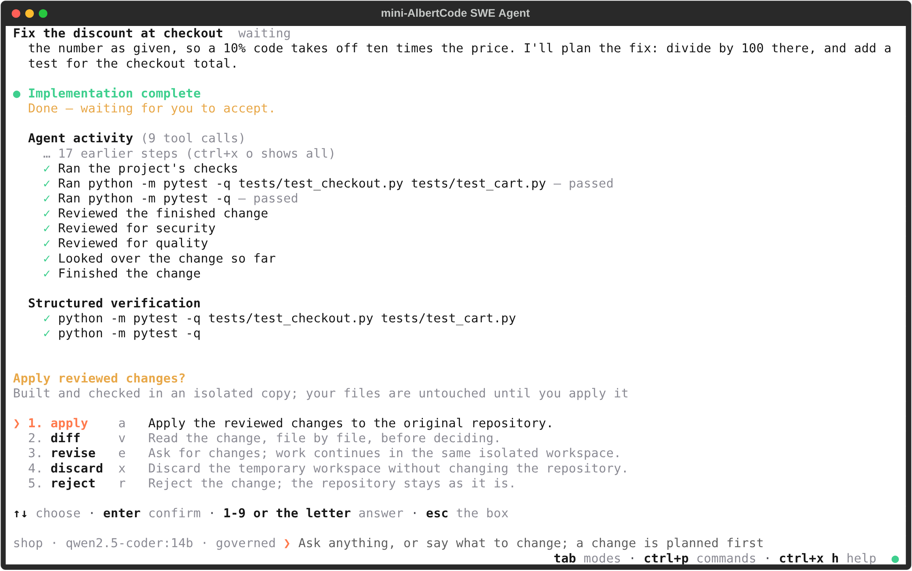
</picture>

<sub>The same session in <code>albert-mini</code>. Answer the gate in either one.</sub>

</td>
</tr>
</table>

<details>
<summary><b>Watch it work, step by step</b></summary>

<br>

<picture>
  <source media="(prefers-color-scheme: dark)" srcset="assets/readme/screen-working-dark.png">
  <source media="(prefers-color-scheme: light)" srcset="assets/readme/screen-working-light.png">
  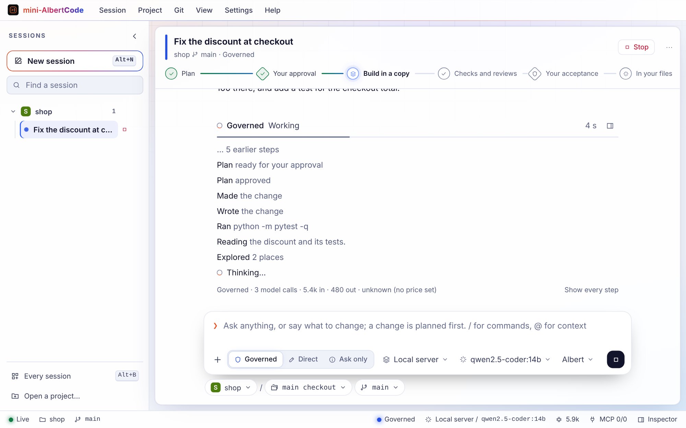
</picture>

<sub>Each step shows as it lands, with the one under way and the time it has been at it. A pressed answer
says so on its button at once.</sub>

</details>

<details>
<summary><b>Or just ask</b></summary>

<br>

<picture>
  <source media="(prefers-color-scheme: dark)" srcset="assets/readme/screen-ask-dark.png">
  <source media="(prefers-color-scheme: light)" srcset="assets/readme/screen-ask-light.png">
  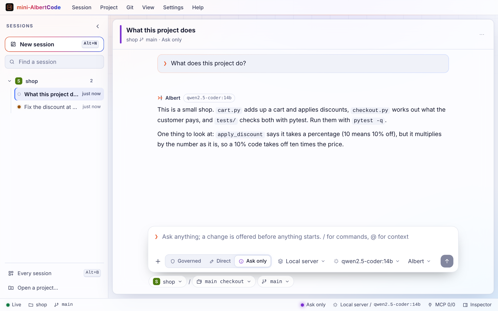
</picture>

<sub>Questions are answered in every mode, from the repository's own files, each file it reads shown as it
reads it. Nothing changes.</sub>

</details>

<br>

## Why mini-AlbertCode

<table>
<tr>
<td width="50%" valign="top">
<br>
<b>Two interfaces, one live session</b><br>
<sub>The terminal (<code>albert-mini</code>) and the browser (<code>albert-mini web</code>) show the same sessions at the same moment. An answer given in one is seen at once in the other.</sub>
</td>
<td width="50%" valign="top">
<br>
<b>Approval built in</b><br>
<sub>Two clear decision points, at the plan and at the result, so nothing reaches your repository by surprise.</sub>
</td>
</tr>
<tr>
<td width="50%" valign="top">
<br>
<b>Changes are proven, not just written</b><br>
<sub>The AlbertCode engine runs your project's own tests and checks, reviews the change for security and quality, and shows what passed and what didn't.</sub>
</td>
<td width="50%" valign="top">
<br>
<b>Choose your pace</b><br>
<sub><i>Governed</i> for changes you care about, <i>direct</i> to work in your files with a prompt before each write (or none, with <i>auto-approve</i>), and <i>ask only</i> to explore without changing anything.</sub>
</td>
</tr>
<tr>
<td width="50%" valign="top">
<br>
<b>Any model</b><br>
<sub>Connect a hosted provider, any compatible service, or a model on your own machine, and switch at any time.</sub>
</td>
<td width="50%" valign="top">
<br>
<b>Private by default</b><br>
<sub>It runs on your machine, with no account and no telemetry.</sub>
</td>
</tr>
<tr>
<td width="50%" valign="top">
<br>
<b>A record of every change</b><br>
<sub>Each task keeps its plan, its steps, its checks, its reviews and its diff together, in both interfaces.</sub>
</td>
<td width="50%" valign="top">
<br>
<b>Extensible</b><br>
<sub><a href="docs/mcp.md">MCP servers</a>, local or remote with sign-in, plus <a href="docs/extending.md">custom commands and agents</a> written as Markdown files.</sub>
</td>
</tr>
</table>

<br>

## How it works

<picture>
  <source media="(prefers-color-scheme: dark)" srcset="assets/readme/flow-dark.png">
  <source media="(prefers-color-scheme: light)" srcset="assets/readme/flow-light.png">
  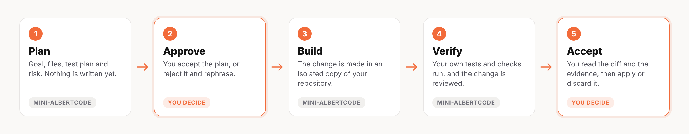
</picture>

| | Step | What you see |
|:-:|---|---|
| **1** | **Plan** | The goal, the files it expects to touch, the test plan and the risk. Nothing is written yet. |
| **2** | **Approve** &nbsp;<sub>you decide</sub> | You approve the plan, ask for changes, or reject it. |
| **3** | **Build** | The change is made in an isolated copy of your repository, never in your working tree. |
| **4** | **Verify** | Your project's own tests and checks run, and the change is reviewed for security and quality. |
| **5** | **Accept** &nbsp;<sub>you decide</sub> | You read the diff and the results, then apply it, ask for changes, or discard it. |

> [!NOTE]
> This is the Governed mode, the default. Accepted changes are ordinary edits: commit them, or undo
> them, with Git. When the reviews block a change, applying it anyway asks for a reason, which is
> recorded.

<br>

## Using mini-AlbertCode

### Two interfaces, one service

Both are views of one local service on your machine (`127.0.0.1:8778`). It starts by itself the first
time either needs it and keeps running, so closing a window never stops a task.

| Interface | Start it | Good for |
|---|---|---|
| **Terminal** | `albert-mini` in your project folder (`--mini` to stay inline) | Working where you already are |
| **Browser** | `albert-mini web` | Reading plans and diffs side by side; every project's sessions in one list |

`albert-mini status` says whether the service is running; `albert-mini stop` stops it.

### Four modes

`tab` cycles them in the terminal. In the browser, Governed, Direct and Ask only are in the box, a click
each, with *Ask each write* or *Auto-approve* beside Direct. Use one for a single message with `/plan`,
`/do` or `/direct auto`.

| Mode | What happens | Use it for |
|---|---|---|
| **Governed** <sub>default</sub> | You approve a plan; it works in an isolated copy, runs your tests and reviews the result; you approve the diff | Changes you care about |
| **Direct · ask each write** | It works in your files, and every write waits for your OK. Git is the undo | Quick changes you're watching |
| **Direct · auto-approve** | It works in your files and carries the change out without asking. Git is the undo | Small, safe changes |
| **Ask only** | It answers, and offers a change; nothing starts until you say go | Understanding a codebase |

### Everyday commands

Type `/help` for all of them.

| Command | What it does |
|---|---|
| `/connect` | Connect a model provider: its key, or the address of a local model |
| `/model` | Choose a model |
| `/plan <request>` | Start a governed change |
| `/do <request>` | Change your files directly, asking before each write |
| `/sessions` | Open, rename, pin or delete sessions |
| `/diff` | This session's change, or your working tree's |
| `/web` | Open this session in the browser |
| `/status` | The service, the engine and what is connected |
| `/exit` | Leave. The service and any task keep running |

For scripts and CI, `albert-mini run "<request>" --approve plan,result` sends one request and answers
the gates you name. See [Commands](docs/commands.md).

### The terminal

`albert-mini` opens a full-screen conversation, drawn as AlbertCode's terminal is: no boxes or lines,
the name in solid letters, and the prompt with the folder, the model and the mode before it.

<picture>
  <source media="(prefers-color-scheme: dark)" srcset="assets/readme/screen-terminal-home-dark.png">
  <source media="(prefers-color-scheme: light)" srcset="assets/readme/screen-terminal-home-light.png">
  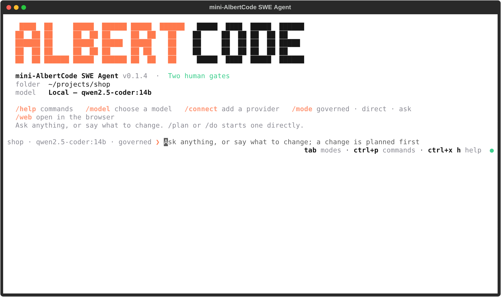
</picture>

| Key | What it does |
|---|---|
| <kbd>Enter</kbd> | Send. A command typed in full runs at once |
| <kbd>Ctrl</kbd> <kbd>J</kbd> | A new line |
| <kbd>Tab</kbd> | The next mode |
| <kbd>/</kbd> and <kbd>@</kbd> | Commands, filtered as you type; mention a file |
| <kbd>Ctrl</kbd> <kbd>P</kbd> | Every command, mode and session in one list |
| <kbd>Ctrl</kbd> <kbd>X</kbd>, then a letter | <kbd>L</kbd> sessions, <kbd>M</kbd> models, <kbd>A</kbd> agents, <kbd>C</kbd> MCP servers, <kbd>D</kbd> the diff, <kbd>B</kbd> the sidebar |
| <kbd>Esc</kbd> | Stop a run; go between the box and a gate |

<details>
<summary><b>Every command, one search away</b></summary>

<br>

<picture>
  <source media="(prefers-color-scheme: dark)" srcset="assets/readme/screen-terminal-help-dark.png">
  <source media="(prefers-color-scheme: light)" srcset="assets/readme/screen-terminal-help-light.png">
  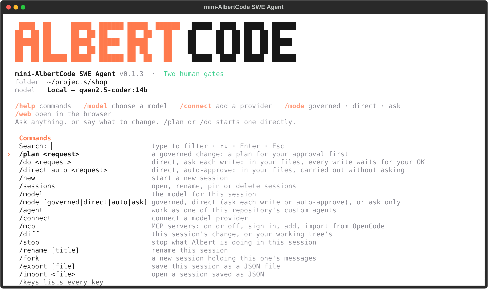
</picture>

<sub><code>/help</code> lists every command to search and run; <code>/keys</code> lists every key; <code>/docs</code> searches the guide.</sub>

</details>

### The browser

`albert-mini web` opens the workspace, signed in, in your default browser. A menu bar holds every command.
The navigator down the left lists every project with its sessions, each with a lamp for what it is
doing. A governed task's session head carries the **gate track**: the work as circles, the two human
gates as diamonds, lit where the task stands. You type at the console's ❯, with the mode, the provider and the
model one click away. The inspector on the right shows the change a file at a time, the context and the
task in full (drag its edge to make it wider or narrower), and a status bar along the foot shows the
service, the branch and the model. Open or clone a project, commit, pull, push, switch branches and make
worktrees from the Project and Git menus. Nebula and Aurora (glass, dark and light, by your system's
setting) and four more themes, shared with the terminal.

<picture>
  <source media="(prefers-color-scheme: dark)" srcset="assets/readme/screen-git-dark.png">
  <source media="(prefers-color-scheme: light)" srcset="assets/readme/screen-git-light.png">
  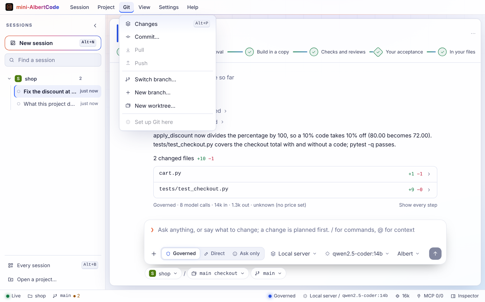
</picture>

| Shortcut | What it does |
|---|---|
| <kbd>Enter</kbd> / <kbd>Shift</kbd> <kbd>Enter</kbd> | Send / a new line |
| <kbd>Ctrl</kbd> <kbd>K</kbd> | Every command |
| <kbd>Alt</kbd> <kbd>N</kbd> | A new session |
| <kbd>Alt</kbd> <kbd>B</kbd> | Every session |
| <kbd>Alt</kbd> <kbd>P</kbd> | Show or hide the inspector |
| <kbd>Alt</kbd> <kbd>M</kbd> | Choose the model |
| <kbd>Alt</kbd> <kbd>S</kbd> | Show or hide the agent's steps |

Help (or `/docs` in the box) searches the user guide as you type and reads the section that answers you,
offline. The terminal has the same search as `/docs`, and a shell as `albert-mini docs <words>`.

<details>
<summary><b>A new session opens on a launchpad</b></summary>

<br>

<picture>
  <source media="(prefers-color-scheme: dark)" srcset="assets/readme/screen-launchpad-dark.png">
  <source media="(prefers-color-scheme: light)" srcset="assets/readme/screen-launchpad-light.png">
  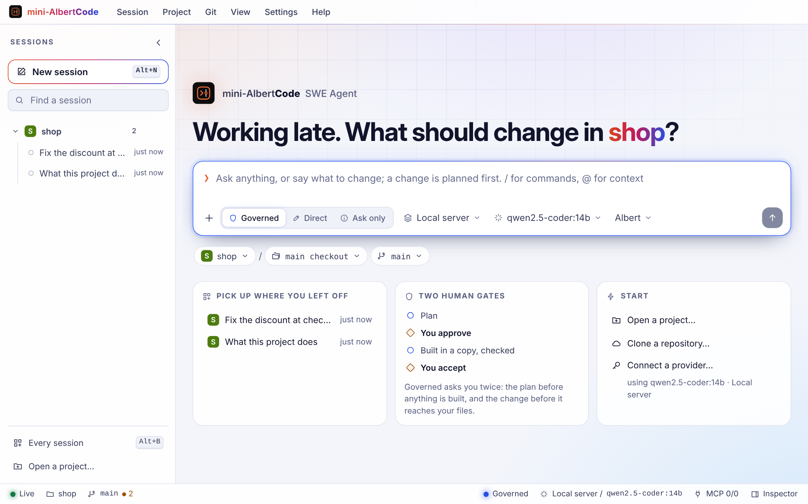
</picture>

<sub>The project's sessions to pick up again, how the two gates work (in Governed), and ways to start: open
or clone a project, or connect a provider.</sub>

</details>

<details>
<summary><b>MCP servers: a connector in a click</b></summary>

<br>

<picture>
  <source media="(prefers-color-scheme: dark)" srcset="assets/readme/screen-mcp-dark.png">
  <source media="(prefers-color-scheme: light)" srcset="assets/readme/screen-mcp-light.png">
  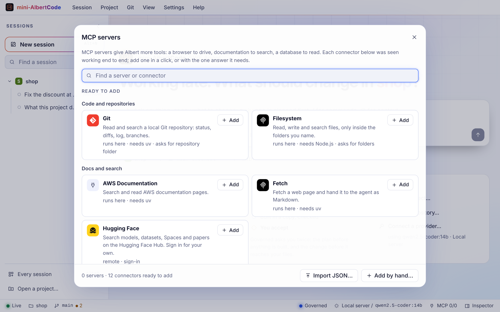
</picture>

<sub>Twelve connectors ready to add, each seen working end to end; a server of your own by hand, or several
at once from an <code>mcpServers</code> JSON file. See <a href="docs/mcp.md">MCP servers</a>.</sub>

</details>

### Gates

A gate is where a change waits for you. Each answer has a key, the same in both interfaces:

| Gate | Answers |
|---|---|
| **The plan** | <kbd>A</kbd> approve and build · <kbd>E</kbd> ask for changes · <kbd>D</kbd> read the whole plan · <kbd>R</kbd> reject |
| **The result** | <kbd>A</kbd> accept into your files · <kbd>V</kbd> view the diff · <kbd>E</kbd> ask for changes · <kbd>X</kbd> discard · <kbd>R</kbd> reject |
| **A write** (Direct · ask each write) | <kbd>A</kbd> allow once · <kbd>Shift</kbd> <kbd>A</kbd> allow the rest of the task · <kbd>N</kbd> decline |
| **A change offered** (Ask only) | <kbd>P</kbd> plan it first · <kbd>O</kbd> do it directly |

> [!NOTE]
> An answer given in one interface is seen at once in the other, and a task is never answered twice.

### Sessions

A session is one conversation and its tasks. Sessions belong to the service, not to a window, and each
runs on its own: switch to another while one works. Rename, pin, fork, stop, archive, delete, export or
import them from either interface, or take a whole project off the list; `albert-mini -c` continues the
latest one in a folder. See [Sessions](docs/sessions.md).

<br>

## Models

| Provider | Connect with |
|---|---|
| OpenRouter | An API key: many vendors' models through one account |
| OpenAI, Anthropic, Kimi | An API key |
| Hugging Face | A token, for open-weight models |
| Any OpenAI-compatible service | Its address, and a key if it needs one |
| Your own machine | Ollama, LM Studio, llama.cpp or another local model server |

Its address comes with `https://` (or `http://` on your machine) already there, the key is checked as you
type it, and the models it can use are listed to choose one; DeepSeek, Groq, Mistral, Together AI and xAI
are offered by name. A provider is shown as connected only once it has accepted your key, or once its
server answers with a model. Keys are kept by your system's own protection and never shown again. The
model must support tool calling; `albert-mini models test` checks one. [**Speed**](docs/browser.md#settings)
(Settings, or `/speed` in the terminal) sets how much the model thinks at each step: Fast, the default,
answers and reviews sooner and plans and builds as deeply as ever; Thorough thinks longest at every step.
More in [Models](docs/models.md).

<picture>
  <source media="(prefers-color-scheme: dark)" srcset="assets/readme/screen-connect-web-dark.png">
  <source media="(prefers-color-scheme: light)" srcset="assets/readme/screen-connect-web-light.png">
  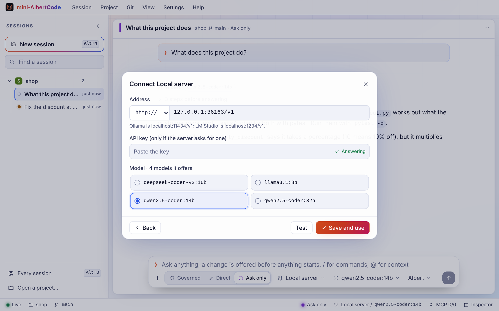
</picture>

<picture>
  <source media="(prefers-color-scheme: dark)" srcset="assets/readme/screen-connect-dark.png">
  <source media="(prefers-color-scheme: light)" srcset="assets/readme/screen-connect-light.png">
  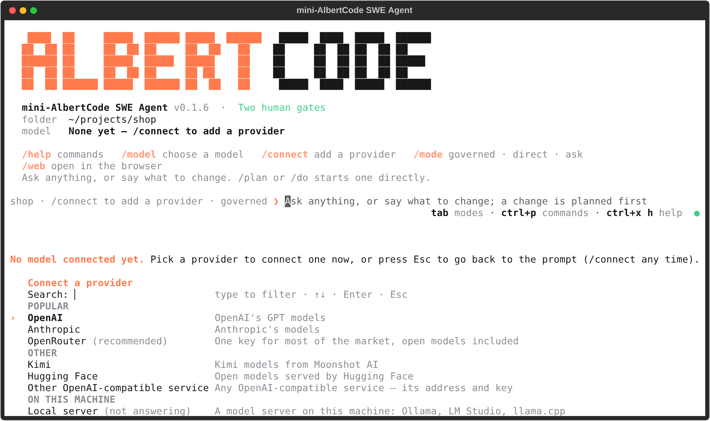
</picture>

<br>

## Troubleshooting

<details>
<summary><b>Installing</b> &nbsp;·&nbsp; command not found, macOS and Windows warnings, Linux, networks</summary>

<br>

| Problem | Fix |
|---|---|
| `albert-mini: command not found` right after installing | Open a new terminal. The installer added the command to your PATH, and only new terminals see it |
| **macOS:** "Apple could not verify…" or "unidentified developer" | Open **System Settings → Privacy & Security**, click **Open Anyway**, and open the installer again. Or use the one-line command |
| **Windows:** "Windows protected your PC" | Choose *More info* → *Run anyway* |
| **Windows:** PowerShell refuses to run the command | Your organisation may block scripts. Download the `.cmd` installer from the release and double-click it instead |
| **Windows:** the old files are in use | Close every terminal that uses mini-AlbertCode (or run `albert-mini stop`), then run the installer again |
| **Linux:** the installer refuses to run under `sudo` | Run it as yourself. It installs for your user, and asks for your password only for what needs it |
| **Linux:** the install fails on Alpine or another musl-based system | Not supported: mini-AlbertCode needs a glibc-based distribution such as Ubuntu, Debian or Fedora |
| pypi.org can't be reached | Check your connection. Behind a proxy, set `HTTPS_PROXY` and run the command again |

Every installer run writes a log: `~/.local/share/mini-albertcode-installer/install.log` on macOS and
Linux, `%LOCALAPPDATA%\mini-albertcode-installer\install.log` on Windows.

</details>

<details>
<summary><b>Running</b> &nbsp;·&nbsp; the service, models, gates</summary>

<br>

| Problem | Fix |
|---|---|
| `No model connected yet.` | Pick a provider in the list that opens, or run `/connect` |
| A provider shows `key not accepted` | The provider refused the key. Connect it again with a new one |
| A local server shows `not answering` | Start your model server, then check its address with `/connect` |
| The model answers but never changes anything | It may not support tool calling. Run `albert-mini models test` |
| `Waiting for the service at http://127.0.0.1:8778 …` | It is starting. If it keeps waiting, run `albert-mini doctor`, then `albert-mini stop` and try again |
| A change is waiting and nothing happens | It is at a gate: answer it in either interface (`albert-mini -c` reopens the session) |
| Anything else | `albert-mini doctor` checks the installation and the service, and says what to do |

</details>

> [!TIP]
> Still stuck? [Open an issue](https://github.com/huynvic/mini-albertcode-swe-agent/issues/new/choose)
> with what you ran, what you expected and what happened, plus `albert-mini --version` and your operating
> system. More fixes are in [Troubleshooting](docs/troubleshooting.md).

> [!CAUTION]
> Never include keys, tokens or private code in an issue.

<br>

## Privacy and security

<table>
<tr>
<td width="50%" valign="top">

**Your code** goes only to the model provider you choose, and to MCP servers you add. With a local
model, it never leaves your machine.

**No telemetry and no account.**

</td>
<td width="50%" valign="top">

**Saved keys** are kept by your system's own protection (the macOS Keychain, Windows data protection or
your Linux keyring), and are never given to the commands it runs.

**Only this installation** can use the service it runs on your computer: it listens on this machine and
needs this installation's access token.

</td>
</tr>
</table>

See the [security model](docs/security.md) and [PRIVACY.md](PRIVACY.md). To report a vulnerability,
follow [SECURITY.md](SECURITY.md).

<br>

## Documentation

The full guide covers every command, key and gate, with examples.

| Guide | What's in it |
|---|---|
| [**Getting started**](docs/getting-started.md) | Install, connect a model, and complete a first task |
| [**How mini-AlbertCode works**](docs/how-it-works.md) | The service, the two interfaces, the modes, the gates, sessions and tasks |
| [**Using mini-AlbertCode**](docs/usage.md) | The short version of everything, with links |
| [**The terminal**](docs/terminal.md) | The prompt, every key, slash command and list |
| [**The browser**](docs/browser.md) | The workspace: navigator, gate track, console, inspector; every shortcut |
| [**Modes and approvals**](docs/modes-and-approvals.md) | The four modes, the two gates and every answer |
| [**Sessions**](docs/sessions.md) | Opening, renaming, forking, exporting and importing |
| [**Models**](docs/models.md) | Providers, local models, and what a model needs |
| [**MCP servers**](docs/mcp.md) | Adding servers, sign-in, the connector catalogue, importing |
| [**Custom commands and agents**](docs/extending.md) | Prompts you call by name, and roles that narrow a task |
| [**Commands**](docs/commands.md) | Every `albert-mini` command and option |
| [**Installation**](docs/installation.md) | Options, updating, uninstalling and requirements |
| [**Security model**](docs/security.md) | How your keys, code and data are protected |
| [**Troubleshooting**](docs/troubleshooting.md) | Fixes for common problems |
| [**FAQ**](docs/faq.md) | Short answers |
| [**Glossary**](docs/glossary.md) | Every term, in one place |

<br>

## FAQ

<details>
<summary><b>How is mini-AlbertCode related to AlbertCode SWE Agent?</b></summary>

<br>

mini-AlbertCode carries the AlbertCode engine, and does everything the engine does the same way:
planning, the isolated copy, the checks, the reviews and the approval gates. It puts two interfaces on
it, a full-screen terminal and a browser workspace, over one local service, so a session is live in both
at once. It is installed and run separately, and keeps its settings, keys and history under its own
name.

</details>

<details>
<summary><b>Is mini-AlbertCode open source?</b></summary>

<br>

No. mini-AlbertCode SWE Agent is a proprietary product. This repository is open: its installer
scripts and its documentation welcome contributions. See [the FAQ](docs/faq.md).

</details>

<details>
<summary><b>Does it cost anything?</b></summary>

<br>

You use your own model provider account, or a free local model. mini-AlbertCode doesn't charge for model
usage.

</details>

<br>

## Community

| | |
|---|---|
| **Bugs and feature requests** | [Issues](https://github.com/huynvic/mini-albertcode-swe-agent/issues/new/choose) |
| **What's new** | The [changelog](CHANGELOG.md) and the [releases](https://github.com/huynvic/mini-albertcode-swe-agent/releases) |
| **Contributing** | Docs and the installer. See [CONTRIBUTING.md](CONTRIBUTING.md) |

<div align="center">

<br>

**If mini-AlbertCode saves you time, a ⭐ helps other developers find it.**

</div>

<br>

## License

mini-AlbertCode SWE Agent is proprietary software, and it isn't covered by the licences in this
repository. Code in this repository is [Apache-2.0](LICENSE), and its documentation is
[CC BY 4.0](https://creativecommons.org/licenses/by/4.0/). See [LICENSING.md](LICENSING.md).

<div align="center">
<br>

</div>
