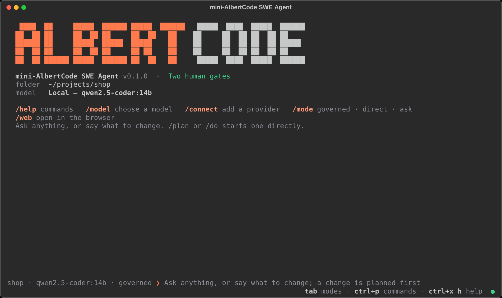
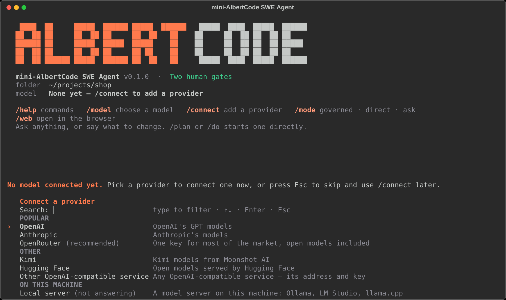
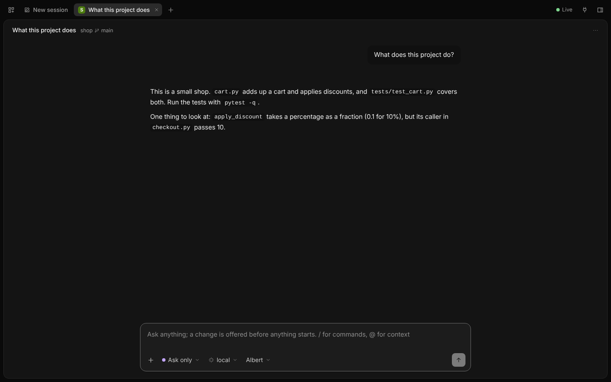

<div align="center">


<h1>mini-AlbertCode SWE Agent</h1>

<p>A coding agent for your terminal and your browser, on one local service, with the AlbertCode engine's two human gates.</p>

<p>
<a href="https://github.com/huynvic/mini-albertcode-swe-agent/releases/latest"></a>
<a href="docs/installation.md"></a>
<a href="https://github.com/huynvic/mini-albertcode-swe-agent/actions/workflows/checks.yml"></a>
</p>

<h3>
<a href="#install">Install</a>
<span>&nbsp;·&nbsp;</span>
<a href="#quick-start">Quick start</a>
<span>&nbsp;·&nbsp;</span>
<a href="#how-it-works">How it works</a>
<span>&nbsp;·&nbsp;</span>
<a href="docs/README.md">Docs</a>
<span>&nbsp;·&nbsp;</span>
<a href="https://github.com/huynvic/mini-albertcode-swe-agent/releases">Releases</a>
</h3>

<br>



<sub>The terminal interface on a new conversation.</sub>

</div>

<br>

## Contents

- [Install](#install) · [Update and uninstall](#update-and-uninstall) · [Quick start](#quick-start)
- [How it works](#how-it-works) · [The terminal](#the-terminal) · [The browser](#the-browser) · [Models](#models)
- [Troubleshooting](#troubleshooting) · [Privacy and security](#privacy-and-security) · [Documentation](#documentation)

## Install

One command installs mini-AlbertCode for your user. Pick your system:

#### macOS and Linux &nbsp;<sub>Terminal</sub>

```bash
curl -fsSL https://raw.githubusercontent.com/huynvic/mini-albertcode-swe-agent/main/installer/install.sh | sh
```

#### Windows &nbsp;<sub>PowerShell</sub>

```powershell
irm https://raw.githubusercontent.com/huynvic/mini-albertcode-swe-agent/main/installer/install.ps1 | iex
```

The command picks the installer built for your machine and checks it against the release's published
SHA-256 checksum before running it. The installer then checks your machine and shows what it found and
what it will do, and asks `Proceed? [Y/N]` before it changes anything. It installs everything
mini-AlbertCode needs, including Python, for your user only: no pip, virtual environments or PATH editing.

```text
mini-AlbertCode SWE Agent 0.1.0 installer
Checking this machine. Nothing is changed until you say so.

Found
  Linux            Ubuntu 24.04 LTS, x86_64
  mini-AlbertCode  not installed
  Python           3.12 at /usr/bin/python3.12
  uv               not installed
  Git              2.43.0 at /usr/bin/git
  Browser          /usr/bin/chromium
  Disk             26.9 GB free
  Network          pypi.org reachable

Will do
  1. Download uv 0.9.5 (about 20 MB, checked against its published SHA-256) ...
  2. Use your Python 3.12 (/usr/bin/python3.12); nothing is installed into it.
  3. Install mini-AlbertCode 0.1.0 with its browser tools, in its own environment ...
  4. Use /usr/bin/chromium for the browser tools (no browser download).
  5. Add ~/.local/bin to your PATH in your shell's startup file, so 'albert-mini' works in any new terminal.
  6. Check that it installed: its version, its commands, and its service starting and answering.

Proceed? [Y/N]
```

> [!TIP]
> When it finishes, **open a new terminal**, then check it:
>
> ```bash
> albert-mini --version
> albert-mini doctor
> ```

### Requirements

| | |
|---|---|
| **Windows** | Windows 10 or 11, x64 (the x64 build also runs on ARM PCs). PowerShell 5.1 or 7 |
| **macOS** | macOS 11 or later, on Apple silicon or Intel |
| **Linux** | x86-64 with glibc: Ubuntu 20.04+, Debian 10+, Fedora, RHEL 8+, openSUSE, Arch. Not Alpine or other musl systems |
| **Disk** | About 1 GB free |
| **Network** | pypi.org and github.com while installing; your model provider while working |
| **Git** | Needed. The installer installs it if it's missing, after asking |

You don't need Python: the installer uses your Python 3.12 if you have one, and otherwise downloads one
for mini-AlbertCode alone. Every option, manual downloads, proxies and checksums are in
[Installation](docs/installation.md).

## Update and uninstall

### Update

```bash
albert-mini update
```

It finds the latest release, says whether it is newer than yours, and runs its installer. The installer
finds the version you have, shows its plan (`Update mini-AlbertCode 0.1.0 to 0.2.0 ...`) and asks
`Proceed? [Y/N]` before it replaces anything. Running the install command again does the same.

Your sessions are always kept. Saved keys and model choices are kept too, unless the new version carries
a new AlbertCode engine: then the plan says they will be cleared the first time it starts, and you
reconnect with `/connect`.

### Uninstall

```bash
albert-mini uninstall           # the program and the installer's files; asks first
albert-mini uninstall --all     # and your settings, saved keys, sessions and history
albert-mini uninstall --check   # only show what it would do
```

It needs nothing from the internet. The install script can do it too (`--uninstall`); see
[Installation](docs/installation.md#uninstalling). Your repositories are never touched.

## Quick start

```bash
cd your-project
albert-mini
```

The first time, mini-AlbertCode opens **Connect a provider**: pick one (OpenRouter, OpenAI, Anthropic, any
OpenAI-compatible service, or a model server on your machine), give it your key or its address, and choose
a model. Then say what you want:

```text
your-project · gpt-4o · governed ❯ The login endpoint returns 500 when the password is empty. Fix it and add a test.
```

In the Governed mode, mini-AlbertCode reads the repository and proposes a plan, and waits. You approve the
plan. It builds the change in an isolated copy of your repository, runs your tests and reviews the
result, and shows you the diff. You apply it, and only then does the change reach your files.

Prefer the browser? Run `albert-mini web`. Both show the same sessions at the same moment.

> [!TIP]
> [Getting started](docs/getting-started.md) walks through a first task in about five minutes.

## How it works

| Mode | What happens when you ask for a change |
|---|---|
| **Governed** | A plan for your approval first, built in an isolated copy, checked and reviewed; your files change only when you accept the diff. |
| **Direct · ask each write** | Works in your real files; every write waits for your OK. No plan to approve. Git is the undo. |
| **Direct · auto-approve** | Works in your real files and carries the change out without asking. Git is the undo. |
| **Ask only** | Answers, and offers a change; nothing starts until you say go. |

Questions are always just answered, in every mode. `tab` cycles the modes in the terminal; `/mode` lists
them. `/plan …`, `/do …` and `/direct auto …` choose the mode for one message.

**The two human gates.** In the Governed mode a change stops twice for you: at its plan, before anything
is written, and at its result, before anything reaches your files. Each gate's answers have a key (`a`
approve or apply, `e` revise, `r` reject, `x` discard, `v` the diff, `d` the whole plan), the same in both
interfaces, and an answer given in one interface is seen at once in the other. See
[Modes and approvals](docs/modes-and-approvals.md).

**One local service.** The terminal and the browser are two views of one service on your machine
(`127.0.0.1:8778`). It starts by itself the first time either needs it and keeps running in the background,
so closing a window never stops a task. `albert-mini status` says whether it is running; `albert-mini stop`
stops it.

## The terminal



- `enter` sends, `ctrl+j` adds a line, `/` lists commands, `@` mentions a file, `ctrl+p` opens every command.
- `ctrl+x` then a letter: `l` sessions, `m` models, `a` agents, `c` MCP servers, `d` the diff, `s` status,
  `h` help, `b` the sidebar.
- At a gate, the arrows choose an answer and `enter` gives it, or its number or its letter does.
- `/help` lists every command to search and run; `/keys` lists every key.

See [The terminal](docs/terminal.md).

## The browser



`albert-mini web` opens the workspace, signed in, in your default browser. The open session has its
conversation in a centred column, with the side panel for the diff, the session's context and usage, and
the task in full. `Ctrl+K` opens every command; `Alt+N` starts a session, `Alt+B` lists the sessions,
`Alt+P` shows the side panel. See [The browser](docs/browser.md).

## Models

Hosted providers (OpenRouter, OpenAI, Anthropic, Kimi, Hugging Face), any OpenAI-compatible service, or a
model server on your own machine (Ollama, LM Studio, llama.cpp). A provider is said to be connected only
once it has accepted your key, or once its server answers with a model. Keys are kept by your system's own
protection and never shown again. See [Models](docs/models.md).

## Troubleshooting

| Problem | Fix |
|---|---|
| `albert-mini: command not found` right after installing | Open a new terminal: the installer added it to your PATH for new ones. |
| `No model connected yet.` | Connect a provider: it opens by itself on the first start, or `/connect` at any time. |
| `pypi.org could not be reached` while installing | Behind a proxy, set `HTTPS_PROXY` and run the command again. |
| A provider shows `key not accepted` | The provider refused the key. Paste it again with `/connect`. |
| Anything else | `albert-mini doctor` checks the installation and the service, and says what to do. |

See [Troubleshooting](docs/troubleshooting.md).

## Privacy and security

mini-AlbertCode runs on your machine. **It collects no telemetry, no analytics and no usage data, and it
has no account to sign in to.** Your code goes only to the model provider you connect (or nowhere, with a
local model), and to MCP servers you add. Its local service listens on this machine only and needs this
installation's access token. See [Privacy](PRIVACY.md) and [Security](docs/security.md); report a
vulnerability privately as [SECURITY.md](SECURITY.md) says.

## Documentation

Everything is in [docs/](docs/README.md): installation, a first task, the terminal, the browser, modes and
approvals, models, MCP servers, sessions, every command, security, troubleshooting and a glossary.

## Licensing

mini-AlbertCode SWE Agent is proprietary software; its source code is not in this repository. The
installers in this repository's releases are provided under the product's own terms. The bootstrap
scripts here are Apache-2.0 and the documentation is CC BY 4.0: see [LICENSING.md](LICENSING.md).
